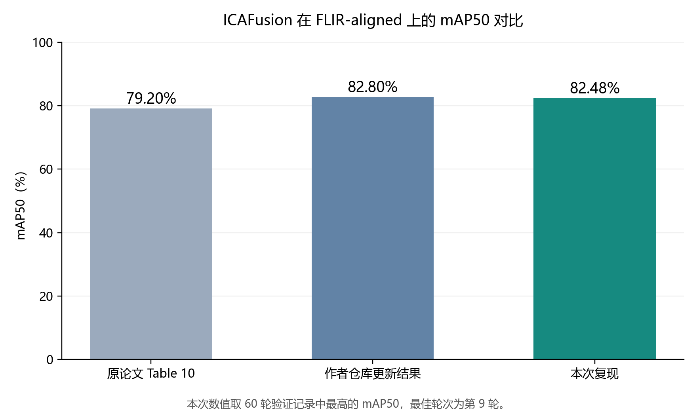
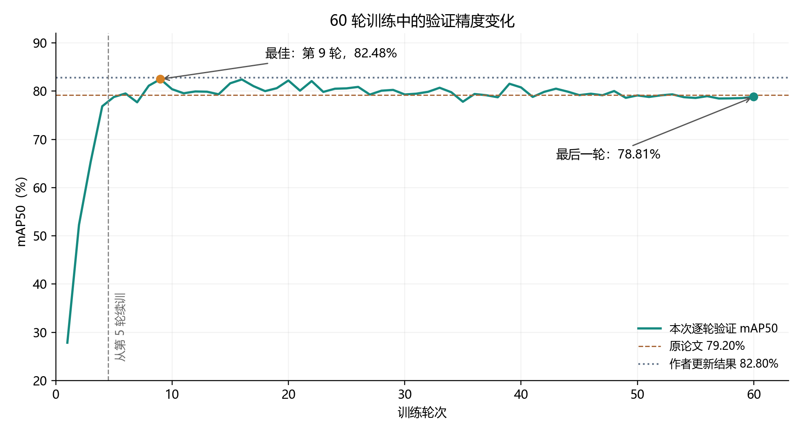

# ICAFusion × FLIR 复现记录

采用作者的 YOLOv5l 双路实现，在 FLIR-aligned 上训练 60 轮。ICAFusion 在检测前用双向交叉注意力交换 RGB 与热红外特征的信息。本次保留了官方三尺度融合、混合池化和默认迭代设置。 [论文](https://arxiv.org/abs/2308.07504) · [本次采用的作者代码版本](https://github.com/chanchanchan97/ICAFusion/tree/6c06b831c70f484b7a434d51cd71e2a2586d1998)

## 数据与训练设置

数据包括 4,129 对训练图像和 1,013 对评估图像，类别为 `person`、`car` 和 `bicycle`，原图尺寸为 640×512。本次在派生标签里去掉 5 个完全重复的标注框，原始图像与标签保持原样。评估图像用于逐轮验证和选择最佳权重。

| 项目 | 设置 |
| --- | --- |
| 环境 | 一张 NVIDIA A100，PyTorch 2.5.1 |
| 训练输入、batch、workers | 640×640，8，8 |
| 训练轮数 | 60 轮，第 5 轮中断并从该轮恢复 |
| 优化器 | SGD，初始学习率 0.01，动量 0.937，权重衰减 0.0005 |
| 调度与增强 | 余弦学习率调度，启用 Mosaic 和随机水平翻转 |
| 验证输入 | 原始图像 640×512，经官方验证加载器填充后为 672×544 |

两段实际运行合计约 4 小时 25 分钟，包含初始化、验证和中断前未完成的一部分计算。 [训练超参数](configs/hyp.yaml)

## 复现结果

| 结果来源 | mAP50 |
| --- | ---: |
| 论文 FLIR 结果 | 79.20% |
| 作者仓库修复代码后的更新结果 | 82.80% |
| 本次第 9 轮 | **82.48%** |
| 本次第 60 轮 | 78.81% |

本次最佳值与作者仓库的更新结果相差 0.32 个百分点。引用时应标出论文和仓库更新结果各自的来源。标注与作者发布版本、预训练权重是否逐项一致，仍需核对。 [预印本表 10](https://arxiv.org/html/2308.07504v1#S4.T10) · [作者仓库的结果更新](https://github.com/chanchanchan97/ICAFusion#results-update)

逐轮 CSV 的 `epoch` 从 0 开始，`epoch=8` 对应上面表格的第 9 轮。结束时自动复评的最佳权重 mAP50 约为 82.5%，对应日志的显示精度。 [60 轮原始指标](metrics/results.csv)

## 复现时遇到的问题

- **旧版 NumPy 与标注去重。** 将旧代码中的 `np.int` 改成 `int`。旧版加载器会因重复框丢弃整张图像，所以在派生标签中去重后再训练。
- **单卡设备定位。** 启动前用 `CUDA_VISIBLE_DEVICES` 指定 GPU UUID，并检查训练进程确实落在指定设备上。把物理设备编号和进程内的可见编号分开核对。
- **断点恢复。** 第 5 轮中途退出时，前 4 轮的检查点完好。恢复时直接加载完整双路模型、优化器和 EMA 状态，跳过用于单路预训练权重初始化的层号转换。检查点未保存随机数及 AMP 缩放器状态，续训轨迹可能与连续运行有差异。

本次完成了一组融合模型训练。单模态贡献和不同融合设置的影响需要另外训练对照组。
