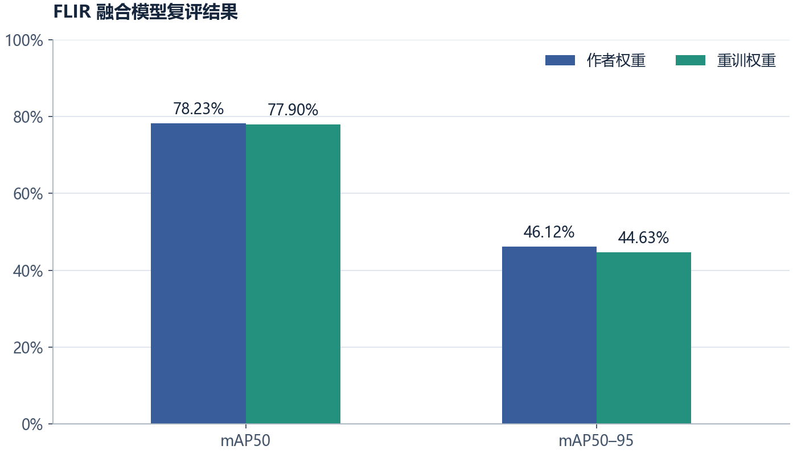

# M²D-LIF × FLIR 单卡复现

这次在 FLIR-aligned 上先评估作者发布的融合权重，再分别训练 RGB 和红外教师，最后用这两套教师训练融合模型。完成范围是 FLIR 主实验，包含两套融合权重的同设置复评。 [论文](https://arxiv.org/html/2503.11780) · [本次采用的作者代码版本](https://github.com/Zhao-Tian-yi/M2D-LIF/tree/210c7ca22b7670e7d4629cca995427bf7e74653f)

## 数据和方法

M²D 用 RGB 和红外两套单模态教师指导融合模型学习。LIF 根据局部光照调节两路特征在融合时的权重。 [论文方法](https://arxiv.org/html/2503.11780#S3)

使用 4,129 对训练图像和 1,013 对评估图像，原图尺寸为 640×512。按作者配置将原标注的 `0=person, 1=car` 转成 `0=car, 1=person`，保留 `2=bicycle`。评估加载器去掉 3 个重复框，使用 8,588 个标注框。这 1,013 对图像用于逐轮验证、选权重和最终复评。

## 训练过程

实验在一张 A100 上串行运行，PyTorch 2.5.1+cu121，输入设置为 `imgsz=640`，`workers=4`，随机种子为 0，关闭 AMP。三组正式训练实际都使用 SGD，初始学习率为 0.01，动量为 0.9。两套教师从 YOLOv8m 配置开始训练，融合模型从作者的 LIF 配置开始，使用 CWD 蒸馏损失，蒸馏权重为 0.8。

| 阶段 | Batch | 实际轮数 | 结束情况 |
| --- | ---: | ---: | --- |
| RGB 教师 | 4 | 200 | 跑满 |
| 红外教师 | 4 | 182 | 早停，保留第 82 轮权重 |
| 蒸馏短跑 | 8 | 1 | 用约 4% 的训练数据先核对流程 |
| 正式融合 | 8 | 160 | 早停，保留第 110 轮权重 |

四个阶段合计约 13 小时 23 分钟，包含初始化和逐轮验证。训练曲线可以对照 [RGB 教师](metrics/rgb-teacher.csv)、[红外教师](metrics/ir-teacher.csv)和[融合模型](metrics/fusion.csv)的逐轮数据。

## 同设置复评

重新加载作者发布的 FLIR 融合权重和本次重训的 `best.pt`，在同一批图像上分别用 CPU、`imgsz=640`、`batch=1`、`conf=0.25` 评估。 [论文表 5](https://arxiv.org/html/2503.11780#S4.T5) · [本次复评原始指标](metrics/paired-evaluation.json)

| 权重来源 | mAP50 | mAP50–95 |
| --- | ---: | ---: |
| 论文表 5 | — | 46.1% |
| 作者融合权重复评 | 78.23% | 46.12% |
| 本次重训权重复评 | 77.90% | 44.63% |
| 重训与作者权重的复评差值 | −0.32 个百分点 | −1.49 个百分点 |

差值按未四舍五入的原始指标计算。训练期间第 110 轮记录的 mAP50 和 mAP50–95 分别为 77.98% 和 44.71%。表格采用重新加载权重之后的复评结果。

## 复现时遇到的问题

- **教师权重和类别编号。** 作者发布了 FLIR 融合权重，这次按作者的教师训练入口单独训练两套教师。准备数据时先核对可见光和红外配对，以及 `car` 和 `person` 的编号。数据配置中的 `path` 需改成各自的数据目录。 [作者权重说明](https://github.com/Zhao-Tian-yi/M2D-LIF#weights) · [RGB 配置](configs/flir-rgb.yaml) · [红外配置](configs/flir-ir.yaml) · [融合配置](configs/flir-fusion.yaml)
- **旧版依赖。** 原环境无法导入 `cv2.gapi`，换用 OpenCV 4.11 后通过了前向检查。加载作者权重时，复现环境还需要 `dill`。
- **实际优化器。** 公开融合脚本填了 `lr0=0.001`，默认 `optimizer=auto` 会重新决定训练参数。作者发布权重的优化器记录为 SGD、初始学习率 0.01、动量 0.9，本次融合训练显式采用了这些值。作者权重记录的融合 batch 是 48，本次单卡用 8，并使用自行重训的教师。教师初始化和 batch 各自对分数的影响需要另做对照。 [作者融合训练入口](https://github.com/Zhao-Tian-yi/M2D-LIF/blob/210c7ca22b7670e7d4629cca995427bf7e74653f/train_dist.py)
