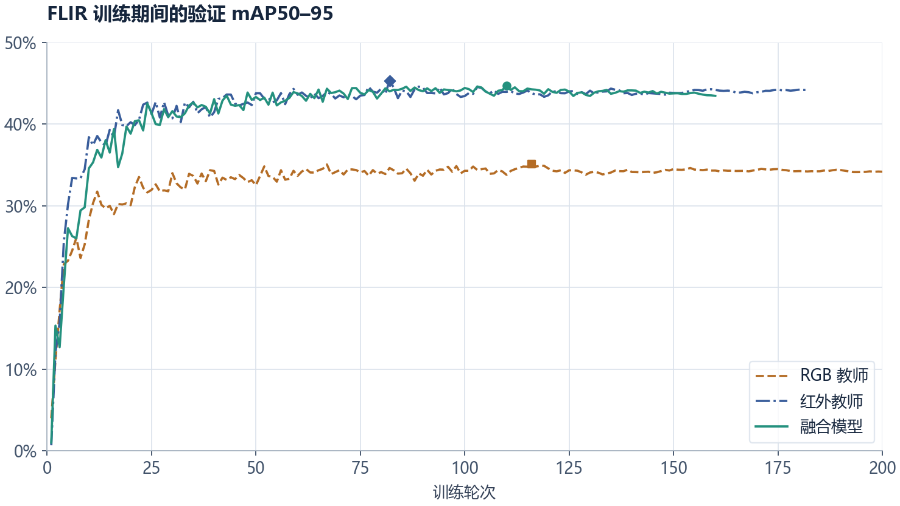

# M²D-LIF × FLIR 单卡复现

这次在 FLIR-aligned 上先评估作者发布的融合权重，再分别训练 RGB 和红外教师，最后用这两套教师训练融合模型。完成范围是 FLIR 主实验，包含两套融合权重的同设置复评。 [论文](https://arxiv.org/html/2503.11780) · [本次采用的作者代码版本](https://github.com/Zhao-Tian-yi/M2D-LIF/tree/210c7ca22b7670e7d4629cca995427bf7e74653f)

## 数据和方法

M²D 用 RGB 和红外两套单模态教师指导融合模型学习。LIF 根据局部光照调节两路特征在融合时的权重。 [论文方法](https://arxiv.org/html/2503.11780#S3)

本次使用 4,129 对训练图像和 1,013 对评估图像，检测汽车、行人和自行车。评估集用于选权重和最终复评。 [RGB 配置](configs/flir-rgb.yaml) · [红外配置](configs/flir-ir.yaml) · [融合配置](configs/flir-fusion.yaml)

## 训练过程

训练使用 `imgsz=640`、`workers=4`，随机种子为 0，关闭 AMP。两套教师从 YOLOv8m 配置开始训练，融合模型从作者的 LIF 配置开始，使用 CWD 蒸馏损失，蒸馏权重为 0.8。

<table>
<thead><tr><th>阶段</th><th align="right">Batch</th><th align="right">实际轮数</th><th>结束情况</th></tr></thead>
<tbody><tr><td>RGB 教师</td><td align="right">4</td><td align="right">200</td><td>跑满</td></tr></tbody>
<tbody><tr><td>红外教师</td><td align="right">4</td><td align="right">182</td><td>早停，保留第 82 轮权重</td></tr></tbody>
<tbody><tr><td>蒸馏短跑</td><td align="right">8</td><td align="right">1</td><td>用约 4% 的训练数据先核对流程</td></tr></tbody>
<tbody><tr><td>正式融合</td><td align="right">8</td><td align="right">160</td><td>早停，保留第 110 轮权重</td></tr></tbody>
</table>

四个阶段合计约 13 小时 23 分钟，包含初始化和逐轮验证。训练曲线可以对照 [RGB 教师](metrics/rgb-teacher.csv)、[红外教师](metrics/ir-teacher.csv)和[融合模型](metrics/fusion.csv)的逐轮数据。

### 实际优化器

公开融合脚本填写 `lr0=0.001`，实际优化器和学习率由 `optimizer=auto` 决定。作者发布权重记录为 **SGD，初始学习率 0.01，动量 0.9**，本次三组正式训练采用了这组设置。 [作者融合训练入口](https://github.com/Zhao-Tian-yi/M2D-LIF/blob/210c7ca22b7670e7d4629cca995427bf7e74653f/train_dist.py)

## 同设置复评

重新加载作者发布的 FLIR 融合权重和本次重训的 `best.pt`，在同一批图像上分别用 CPU、`imgsz=640`、`batch=1`、`conf=0.25` 评估。 [论文表 5](https://arxiv.org/html/2503.11780#S4.T5) · [作者权重](https://github.com/Zhao-Tian-yi/M2D-LIF#weights) · [本次复评原始指标](metrics/paired-evaluation.json)

<table>
<thead><tr><th>权重来源</th><th align="right">mAP50</th><th align="right">mAP50–95</th></tr></thead>
<tbody><tr><td>论文表 5</td><td align="right">—</td><td align="right">46.1%</td></tr></tbody>
<tbody><tr><td>作者融合权重复评</td><td align="right">78.23%</td><td align="right">46.12%</td></tr></tbody>
<tbody><tr><td>本次重训权重复评</td><td align="right">77.90%</td><td align="right">44.63%</td></tr></tbody>
<tbody><tr><td>重训与作者权重的复评差值</td><td align="right">−0.32 个百分点</td><td align="right">−1.49 个百分点</td></tr></tbody>
</table>

差值按未四舍五入的原始指标计算。训练期间第 110 轮记录的 mAP50 和 mAP50–95 分别为 77.98% 和 44.71%。表格采用重新加载权重之后的复评结果。

